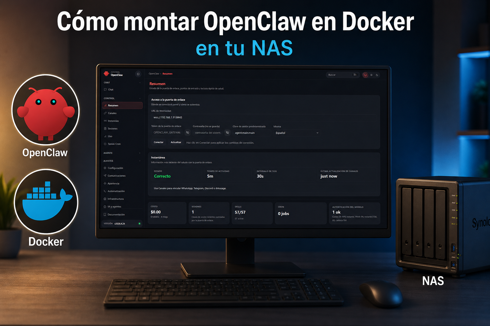

# OpenClaw en NAS

[English](README.md) | **Español**

<p align="center">
  
  
  
  
  
  
</p>

<p align="center">
  
</p>

Ejecuta [OpenClaw](https://openclaw.ai) en un NAS con Docker, HTTPS local y
acceso **solo desde tu red local (LAN)**. No abras puertos de OpenClaw en el
router.

```text
Navegador en la LAN -> https://<ip-del-nas>:8443 -> Proxy TLS Nginx -> Gateway de OpenClaw (127.0.0.1:18789)
```

El NAS usa una imagen ya construida que publica este repositorio. Nunca la
construye en local:

| Registro | Imagen |
| -------- | ------ |
| GitHub Container Registry (por defecto) | `ghcr.io/luprintech/openclaw-nas-docker` |
| Docker Hub (réplica) | `luprintechdev/openclaw-nas-docker` |

GitHub Actions construye la imagen a partir del `Dockerfile`, la prueba y la
publica; `docker-compose.yml` solo la descarga y la ejecuta.

## Índice

- [Requisitos](#requisitos)
- [Vídeo tutorial](#vídeo-tutorial)
- [Primera instalación, paso a paso](#primera-instalación-paso-a-paso)
- [Comandos habituales](#comandos-habituales)
- [Actualizar OpenClaw](#actualizar-openclaw)
- [Canales de publicación](#canales-de-publicación)
- [Copias de seguridad y restauración](#copias-de-seguridad-y-restauración)
- [Volver a ejecutar el instalador](#volver-a-ejecutar-el-instalador)
- [Instalar el rootCA en los dispositivos](#instalar-el-rootca-en-los-dispositivos)
- [Claude Code CLI](#claude-code-cli)
- [Instalar skills de Python](#instalar-skills-de-python)
- [Solución de problemas](#solución-de-problemas)
- [Normas de seguridad](#normas-de-seguridad)
- [Documentos del proyecto](#documentos-del-proyecto)

---

## Requisitos

- Un NAS con **procesador x86-64 (amd64)**. Las imágenes solo se publican para
  `linux/amd64`, así que los modelos con procesador ARM no pueden ejecutarlas.
- Docker con **Docker Compose v2** (`docker compose version` tiene que
  funcionar). En Synology, instala **Container Manager** desde el Centro de
  paquetes.
- Acceso SSH al NAS con un usuario que pueda ejecutar `docker`.
- `curl` en el NAS para descargar el instalador y las actualizaciones.
- Una IP fija en la LAN para el NAS (ver el paso 0).

Probado en Synology DSM, incluidos modelos con kernel Linux 4.4 como el DS220+.
Debería funcionar en otros NAS x86-64 que ejecuten Docker (QNAP, Ugreen,
TerraMaster, Asustor, etc.).

---

## Vídeo tutorial

[](https://youtu.be/lEqvOU_WuP0?si=V4EjXpC46ehEahsi)

---

## Primera instalación, paso a paso

Los ejemplos usan `192.168.1.50` como IP del NAS y `/volume1/docker/openclaw`
como carpeta de instalación. Cámbialos por los tuyos.

> **Norma de seguridad:** OpenClaw solo debe ser accesible desde la LAN. **No**
> abras los puertos `8443` ni `18789` en el router.

### 0. Dale al NAS una IP fija en la LAN

El instalador guarda la IP del NAS en `.env` y la usa para la URL del panel,
los orígenes permitidos del navegador y el certificado HTTPS. Si la IP cambia
más adelante, todo eso deja de coincidir y tendrás que volver a ejecutar el
instalador con la IP nueva.

| Opción | ¿Recomendada? | Ventajas e inconvenientes |
| ------ | ------------- | ------------------------- |
| Reserva DHCP en el router | **La mejor opción** | El router siempre le da la misma IP al NAS. Poco riesgo y fácil de deshacer. |
| IP estática en el panel del NAS | Buena opción | No hay que tocar el router, pero una puerta de enlace, DNS o máscara incorrectos pueden dejar el NAS sin red. |
| IP estática por SSH | No recomendada en Synology | DSM gestiona la red y puede sobrescribir los cambios. Es fácil quedarse sin acceso. |

**Recomendado: reservar la IP en el router**

1. Entra en la página de administración del router y busca el NAS en la lista
   de clientes DHCP o LAN.
2. Copia su dirección MAC.
3. Crea una reserva DHCP (también llamada "IP estática" o "reserva de
   dirección") para esa MAC, por ejemplo `192.168.1.50`.
4. Reinicia el NAS o renueva su concesión de red.
5. Comprueba que el NAS responde en esa IP.

**Synology DSM: poner una IP manual desde el panel**

1. En DSM, abre **Panel de control → Red → Interfaz de red**.
2. Selecciona la interfaz activa (normalmente **LAN 1**) y pulsa **Editar**.
3. En IPv4, elige la configuración manual e indica la IP (por ejemplo
   `192.168.1.50`), la máscara de subred (normalmente `255.255.255.0`), la
   puerta de enlace (tu router, por ejemplo `192.168.1.1`) y el servidor DNS.
4. Aplica los cambios y vuelve a entrar en DSM con la IP nueva.

Una puerta de enlace, máscara o rango de IP incorrectos pueden dejarte sin
acceso a DSM hasta que lo arregles en local, así que revisa bien los valores.
Usa SSH solo para consultar la IP actual (`ip addr`), no para fijarla.

### 1. Conéctate al NAS y crea la carpeta de instalación

| NAS | Ruta sugerida |
| --- | ------------- |
| Synology | `/volume1/docker/openclaw` |
| QNAP | `/share/Container/openclaw` |
| Otros | `/opt/openclaw` o cualquier carpeta con permisos de escritura |

```bash
ssh tu-usuario@192.168.1.50
mkdir -p /volume1/docker/openclaw
cd /volume1/docker/openclaw
```

En Synology, activa antes SSH en **Panel de control → Terminal y SNMP**.

### 2. Descarga y ejecuta el instalador

```bash
curl -fsSL https://raw.githubusercontent.com/luprintech/openclaw-nas-docker/main/install.sh -o install.sh
chmod +x install.sh
./install.sh 192.168.1.50
```

Ejecútalo desde la carpeta de instalación y deja `install.sh` ahí: lo
necesitarás si cambia la IP o el puerto. No lo lances con `bash <(curl ...)`,
porque de esa forma no encuentra la carpeta de instalación.

El instalador:

1. Comprueba que Docker y Docker Compose v2 están disponibles.
2. Crea `.env` con un `OPENCLAW_GATEWAY_TOKEN` aleatorio, tu zona horaria y la
   IP del NAS.
3. Genera una autoridad de certificación local y un certificado HTTPS para la
   IP del NAS en `certs/`.
4. Escribe `docker-compose.yml`, `nginx/nginx.conf` y el comando `./openclaw`.
5. Crea `config/` y `workspace/` y se los asigna al UID/GID 1000, el usuario
   con el que se ejecuta OpenClaw dentro del contenedor.
6. Descarga la imagen si todavía no está en el NAS y arranca los contenedores.
7. Aplica los orígenes permitidos de la Control UI y la configuración del proxy
   inverso.

Al terminar, muestra la URL del panel y la ruta del certificado raíz.

### 3. Confía en el certificado raíz local en cada dispositivo

El instalador ha creado una autoridad de certificación privada para tu LAN.
Copia su certificado raíz del NAS a cada ordenador o móvil desde el que vayas a
abrir OpenClaw:

- `certs/rootCA.cer` para Windows
- `certs/rootCA.pem` para macOS, iPhone/iPad, Android y Linux

Puedes copiarlo con File Station (Synology) o con `scp`. Después instálalo como
autoridad raíz de confianza: consulta
[Instalar el rootCA en los dispositivos](#instalar-el-rootca-en-los-dispositivos).

Si te saltas este paso, el navegador avisará de que la conexión no es privada.
Es lo esperado con un certificado privado de la LAN.

### 4. Abre el panel

Abre la URL HTTPS en el navegador:

```text
https://192.168.1.50:8443
```

No hay dirección HTTP sin cifrar. El puerto `18789` solo escucha dentro del
propio NAS (`127.0.0.1`), así que `http://192.168.1.50:18789` no funcionará
desde tu ordenador.

Si el panel te pide el token del gateway, consúltalo en el NAS y pega solo el
valor que va después del `=`:

```bash
grep OPENCLAW_GATEWAY_TOKEN .env
```

### 5. Haz el onboarding y configura tu proveedor de IA

```bash
./openclaw onboard
```

El onboarding se ejecuta dentro del contenedor. Sigue las indicaciones para
elegir tu proveedor de IA e introducir su clave de API o iniciar sesión. **Aquí
es donde se configuran los proveedores.**

El archivo `.env` tiene entradas vacías como `ANTHROPIC_API_KEY` u
`OPENAI_API_KEY`, pero los contenedores no las leen. Rellenarlas no tiene
ningún efecto; usa el onboarding.

### 6. Empareja tu navegador

El emparejamiento autoriza a tu navegador como dispositivo conocido.

1. Muestra la información del panel y del emparejamiento:

   ```bash
   ./openclaw dashboard
   ```

2. Abre la URL que aparece en el navegador, introduce el token del gateway si
   te lo pide e inicia el emparejamiento.
3. De vuelta en SSH, lista los dispositivos pendientes:

   ```bash
   ./openclaw devices
   ```

4. Copia el `request_id` de tu navegador y apruébalo:

   ```bash
   ./openclaw approve <request_id>
   ```

5. Recarga el navegador. Ya está emparejado.

### 7. Comprueba que todo funciona

```bash
./openclaw status
./openclaw doctor
```

`status` debe mostrar los dos contenedores como `Up` y el gateway como
`healthy`. Si algo falla, revisa los logs:

```bash
./openclaw logs openclaw-gateway
./openclaw logs nginx
```

Pulsa `Ctrl+C` para dejar de seguir los logs.

---

## Comandos habituales

Ejecútalos desde la carpeta de instalación.

**OpenClaw** (los contenedores tienen que estar en marcha):

| Comando | Qué hace |
| ------- | -------- |
| `./openclaw onboard` | Ejecuta el onboarding de OpenClaw |
| `./openclaw dashboard` | Muestra la URL del panel y del emparejamiento |
| `./openclaw devices` | Lista los dispositivos conocidos y pendientes |
| `./openclaw approve <request_id>` | Aprueba una solicitud de emparejamiento |
| `./openclaw doctor` | Ejecuta el diagnóstico de OpenClaw |
| `./openclaw agent --message "hola"` | Habla con el asistente |
| `./openclaw message send --target <destino> --message "hola"` | Envía un mensaje por un canal |
| `./openclaw pip install <paquete>` | Instala un paquete de Python para skills |
| `./openclaw claude` | Abre Claude Code CLI |
| `./openclaw <cualquier otro>` | Pasa el comando a la CLI de OpenClaw, por ejemplo `./openclaw config get gateway.bind` |

**Contenedores:**

| Comando | Qué hace |
| ------- | -------- |
| `./openclaw start` | Crea y arranca los contenedores (`docker compose up -d`). Aplica los cambios de `.env` |
| `./openclaw stop` | Para **y elimina** los contenedores (`docker compose down`). Tus datos de `config/` y `workspace/` se conservan |
| `./openclaw restart` | Reinicia los contenedores existentes. **No** aplica los cambios de `.env`: para eso usa `stop` y después `start` |
| `./openclaw status` | Muestra el estado de los contenedores |
| `./openclaw logs [servicio]` | Sigue los logs de todos los servicios o de uno (`openclaw-gateway`, `nginx`) |
| `./openclaw shell` | Abre una shell en un contenedor CLI temporal |
| `./openclaw update` | Actualiza los archivos y la imagen, y migra tus datos (ver más abajo) |
| `./openclaw help` | Muestra la lista de comandos |

---

## Actualizar OpenClaw

Actualiza siempre con:

```bash
cd /volume1/docker/openclaw
./openclaw update
```

Los contenedores tienen que estar en marcha. Si los paraste, ejecuta antes
`./openclaw start`.

Qué hace `./openclaw update`, por orden:

1. Muestra el banner del actualizador y descarga de este repositorio las
   últimas versiones de `install.sh`, `docker-compose.yml`, `openclaw` y
   `scripts/migrate-openclaw.sh` (o hace `git pull` si la carpeta es un clon de
   Git).
2. Descarga la imagen configurada (`:latest` por defecto).
3. Hace una copia de seguridad de tus datos de OpenClaw, `.env`,
   `docker-compose.yml` y `nginx/` en una carpeta nueva
   `openclaw-backup-<fecha>-<hora>` (ver
   [Copias de seguridad y restauración](#copias-de-seguridad-y-restauración)).
4. Para el gateway, repara los permisos de los archivos y ejecuta las
   migraciones de datos que necesita la nueva versión de OpenClaw.
5. Arranca el gateway, espera a que esté sano (hasta 2 minutos) y reinicia
   Nginx.

Cuando termine, comprueba el resultado:

```bash
./openclaw status
```

> **No actualices solo con `docker compose pull` y `up -d`.** Así se salta la
> migración de datos: las versiones recientes de OpenClaw arrancan con la base
> de datos de agentes degradada, Docker sigue mostrando el gateway como sano y
> la Control UI no carga. Si ya te ha pasado, ejecuta
> `bash scripts/migrate-openclaw.sh upgrade`.

Si una actualización falla, no reinicies el gateway una y otra vez. Guarda la
carpeta de copia de seguridad que te indica y revisa los logs:

```bash
docker compose ps
docker compose logs --since 5m --tail=120 openclaw-gateway
```

El actualizador nunca borra las copias de seguridad ni restaura datos por su
cuenta, así conservas la información y decides tú qué hacer.

En Synology, `openclaw doctor --fix` puede mostrar
`EPERM: operation not permitted, fchmod`. Solo es inofensivo si la
actualización termina, el log del gateway muestra `gateway ready` y
`./openclaw status` muestra el gateway como `healthy`.

> [!IMPORTANT]
> **¿Instalaste antes de la actualización de compatibilidad con Synology
> 2026.9.9?** Actualiza el comando `./openclaw` una vez antes de tu primera
> actualización. No toca tu configuración, tu workspace ni tus sesiones:
>
> ```bash
> curl -fsSL https://raw.githubusercontent.com/luprintech/openclaw-nas-docker/main/install.sh -o install.sh
> bash install.sh --wrapper-only
> ./openclaw update
> ```

---

## Canales de publicación

Cada imagen se publica con varias etiquetas:

| Etiqueta | Cuándo cambia | Úsala si |
| -------- | ------------- | -------- |
| `latest` (por defecto) | Solo después de probar la versión en un NAS Synology real | Quieres un NAS estable. Es la que usan `install.sh` y `docker-compose.yml` |
| `edge` | En cuanto una versión nueva de OpenClaw pasa las pruebas automáticas | Quieres las versiones nuevas antes y sabes recuperarte de una actualización fallida |
| `<versión>` (p. ej. `2026.11.6`) | Nunca; siempre apunta a la misma imagen | Quieres referirte a una compilación concreta |

Cómo llega una versión nueva de OpenClaw a `latest`:

1. Cada seis horas, un workflow comprueba si hay una versión **estable** nueva
   de OpenClaw (las prereleases se ignoran).
2. La CI construye la imagen y ejecuta `scripts/smoke-test.sh`: arranque
   limpio, actualización desde el `latest` actual con los mismos datos, gateway
   sano, base de datos de agentes sin degradar y `claude` funcionando. Si algo
   falla, no se publica nada y se abre una issue con la etiqueta
   `openclaw-update-failed`.
3. Si las pruebas pasan, un pull request fija la versión en `main` y se fusiona
   automáticamente. La imagen se publica como `:<versión>` y `:edge` en GHCR y
   Docker Hub, junto con una prerelease en GitHub y una issue con la etiqueta
   `release-candidate` que contiene la checklist para el NAS.
4. La mantenedora prueba esa imagen en un NAS Synology. Los runners de la CI
   usan un kernel moderno y no pueden reproducir problemas propios del kernel
   Linux 4.4 de algunos modelos de Synology (por ejemplo, la falta de la
   llamada `openat2`).
5. La mantenedora lanza el workflow **Promote to stable**. Copia esa imagen
   exacta a `:latest` en los dos registros sin volver a construirla, marca la
   release de GitHub como la última y cierra la issue de la checklist. Si se
   lanza con una versión anterior, sirve para volver atrás (rollback).

Después de una promoción o de un rollback, ejecuta `./openclaw update` en tu NAS
para recibirlo.

### Seguir el canal `edge`

1. Edita `.env` y pon:

   ```env
   OPENCLAW_IMAGE=ghcr.io/luprintech/openclaw-nas-docker:edge
   ```

2. Ejecuta `./openclaw update`.

Para volver a `latest`, deja el valor vacío (`OPENCLAW_IMAGE=`) y ejecuta
`./openclaw update`. Si `edge` era más nueva que `latest`, eso es volver a una
versión anterior: las migraciones de datos no se pueden deshacer, así que
restaura la copia de seguridad que se hizo antes del cambio (ver
[Copias de seguridad y restauración](#copias-de-seguridad-y-restauración)).

> **Fijar una versión:** `./openclaw update` vacía el valor
> `OPENCLAW_IMAGE=ghcr.io/luprintech/openclaw-nas-docker:<versión>`, así que
> fijar una versión de GHCR no sobrevive a una actualización. Usa `latest` o
> `edge`.

---

## Copias de seguridad y restauración

Cada `./openclaw update` crea una carpeta junto a tu instalación:

```text
openclaw-backup-AAAAMMDD-HHMMSS/
├── openclaw-home/       # Datos de OpenClaw: config, sesiones, agentes, workspace, login de Claude
├── .env
├── docker-compose.yml
└── nginx/
```

Si quieres guardarlas en otro sitio, define `OPENCLAW_BACKUP_ROOT` antes de
actualizar. Las copias contienen tu token del gateway, las claves de los
proveedores y el login de Claude en texto plano: guárdalas en privado y borra
las antiguas que ya no necesites.

Para restaurar una copia (por ejemplo, después de una actualización fallida):

1. Para los contenedores:

   ```bash
   cd /volume1/docker/openclaw
   ./openclaw stop
   ```

2. Aparta los datos actuales en lugar de borrarlos:

   ```bash
   mv config config.before-restore
   mv workspace workspace.before-restore
   ```

3. Copia la copia de seguridad con el propietario correcto. La copia la hace un
   contenedor temporal, porque el usuario de SSH puede no tener permiso para
   leer archivos del UID 1000:

   ```bash
   B=openclaw-backup-AAAAMMDD-HHMMSS
   docker run --rm -v "$PWD:/w" alpine sh -c \
     "cp -a /w/$B/openclaw-home /w/config \
      && if [ -d /w/config/workspace ]; then mv /w/config/workspace /w/workspace; else mkdir /w/workspace; fi \
      && chown -R 1000:1000 /w/config /w/workspace"
   ```

4. Fija en `.env` la versión que tenías antes de actualizar (consulta las
   [releases](https://github.com/Luprintech/openclaw-nas-docker/releases) si no
   estás segura), por ejemplo:

   ```env
   OPENCLAW_IMAGE=ghcr.io/luprintech/openclaw-nas-docker:2026.11.5
   ```

5. Arranca con `./openclaw start` (no con `update`, que borraría la versión
   fijada y volvería a migrar) y comprueba `./openclaw status`.

Cuando todo funcione, puedes borrar `config.before-restore` y
`workspace.before-restore`. Quita la versión fijada y vuelve a ejecutar
`./openclaw update` cuando haya una versión corregida en `latest`.

---

## Volver a ejecutar el instalador

Vuelve a ejecutar el instalador solo para cambiar la IP del NAS o el puerto
HTTPS, o para reparar la instalación:

```bash
./install.sh 192.168.1.60   # IP nueva
./install.sh                # misma IP, la lee de .env
```

Conserva tu token, tus datos y la autoridad de certificación. Reescribe
`docker-compose.yml`, emite un certificado HTTPS nuevo, repara los permisos de
los archivos y vuelve a aplicar los orígenes permitidos y la configuración del
proxy. Si ya existen `nginx/nginx.conf` y `./openclaw`, no los toca.

El instalador **no** actualiza OpenClaw: no descarga una imagen más nueva ni
migra datos. Para eso usa `./openclaw update`.

Para cambiar el puerto HTTPS, edita `OPENCLAW_HTTPS_PORT` en `.env` y vuelve a
ejecutar `./install.sh`, así los orígenes permitidos coinciden con el puerto
nuevo.

---

## Instalar el rootCA en los dispositivos

### Windows

1. Copia `certs/rootCA.cer` al PC.
2. Haz doble clic y elige **Instalar certificado**.
3. Elige **Equipo local**.
4. Colócalo en **Entidades de certificación raíz de confianza**.

### macOS

1. Abre `rootCA.pem`: Acceso a Llaveros lo añade al llavero Sistema.
2. Abre el certificado y en **Al utilizar este certificado** elige
   **Confiar siempre**.

### iPhone / iPad

1. Abre `rootCA.pem` en el dispositivo e instala el perfil.
2. Ve a **Ajustes → General → Información → Ajustes de confianza de
   certificados**.
3. Activa la confianza total para el certificado.

### Android

```text
Ajustes → Seguridad → Cifrado y credenciales → Instalar un certificado → Certificado de CA
```

Los nombres de los menús cambian según el fabricante.

La autoridad de certificación se crea una sola vez y se reutiliza. Al volver a
ejecutar el instalador se emite un certificado de servidor nuevo firmado por la
misma autoridad, así que los dispositivos que ya confían en ella no tienen que
instalarla otra vez.

---

## Claude Code CLI

La imagen incluye Claude Code. `./openclaw claude` lo abre en un contenedor
temporal, y el gateway de OpenClaw puede usar la misma CLI como backend de
modelo `claude-cli` (consulta la
[documentación de backends CLI de OpenClaw](https://docs.openclaw.ai/gateway/cli-backends)).

Los dos contenedores definen `CLAUDE_CONFIG_DIR=/home/node/.openclaw/claude`,
que en el NAS es `config/claude`. Ahí se guardan tu login de Claude, los
ajustes, la memoria y el historial, así que se conservan al cerrar la CLI,
reiniciar los contenedores y actualizar la imagen. Las instalaciones que
actualizan desde una versión antigua tienen que iniciar sesión una vez más.

Inicia sesión una vez y comprueba el estado:

```bash
./openclaw claude                # después ejecuta /login y sigue las indicaciones
docker compose exec openclaw-gateway claude auth status --text
```

Claude Code acepta iniciar sesión con una cuenta de Anthropic o con una clave de
API. Para automatizaciones compartidas o continuas a través del gateway, la
documentación de OpenClaw recomienda una clave de API para que el coste sea
predecible
([almacenamiento en Docker](https://docs.openclaw.ai/install/docker/networking-and-storage)).
Si inicias sesión con una cuenta, revisa las condiciones y los límites de uso
actuales de Anthropic para herramientas de terceros.

`config/claude` guarda tu token de login de Claude en texto plano, igual que el
token del gateway en `.env`. No lo compartas ni lo subas a ningún repositorio.

---

## Instalar skills de Python

El contenedor incluye Python 3 y pip. Los paquetes se instalan en un entorno
virtual en `/home/node/.openclaw/python-venv`, dentro de `config/`, así que se
conservan al reiniciar y al actualizar la imagen.

```bash
./openclaw pip install <paquete>
```

Si te sale `Unknown command: openclaw pip`, tu comando `./openclaw` está
desactualizado. Actualízalo una vez:

```bash
curl -fsSL https://raw.githubusercontent.com/luprintech/openclaw-nas-docker/main/install.sh -o install.sh
bash install.sh --wrapper-only
```

A partir de ahí, `./openclaw update` lo mantiene al día.

---

## Solución de problemas

### `OpenClaw gateway container is not running; start the stack before updating`

`./openclaw update` necesita que exista el contenedor del gateway, porque hace
la copia de seguridad de tus datos desde él. Pasa después de `./openclaw stop`
o si borraste el contenedor en Container Manager. Tus datos de `config/` y
`workspace/` están a salvo. Arranca los contenedores y vuelve a actualizar:

```bash
./openclaw start
./openclaw update
```

### La Control UI no carga después de actualizar

Seguramente actualizaste con `docker compose pull` / `up -d` en lugar de
`./openclaw update`, así que no se ejecutó la migración de datos:

```bash
bash scripts/migrate-openclaw.sh upgrade
```

### Un plugin necesita una API de plugins más nueva que la de OpenClaw

```text
Plugin "@openclaw/whatsapp" requires plugin API >=2026.10.1, but this OpenClaw
runtime exposes 2026.9.9.
```

El plugin se publicó para una versión de OpenClaw más nueva que la que tienes.
Actualiza, comprueba tu versión y vuelve a intentarlo:

```bash
./openclaw update
docker compose exec openclaw-gateway node dist/index.js --version
```

Si el plugin sigue pidiendo una versión más nueva, esa versión de OpenClaw
todavía no ha llegado a `latest` (ver
[Canales de publicación](#canales-de-publicación)). Espera a la siguiente
promoción o cámbiate a `edge` si aceptas el riesgo.

### EACCES: permission denied

OpenClaw se ejecuta como UID/GID `1000` dentro del contenedor. Si las carpetas
de datos pertenecen a otro usuario, verás errores como:

```text
EACCES: permission denied, open '/home/node/.openclaw/openclaw.json...tmp'
```

Corrige el propietario con un contenedor temporal (funciona sin `sudo`):

```bash
docker run --rm -v "$PWD:/w" alpine chown -R 1000:1000 /w/config /w/workspace
./openclaw restart
```

Si la generación de certificados falla con un error de permisos en `certs/`:

```bash
sudo chown -R "$(id -u):$(id -g)" certs
chmod -R u+rwX certs
```

### Conflictos de nombre de contenedor

```text
Conflict. The container name "/openclaw-gateway" is already in use
```

Son restos de una instalación antigua que usaba nombres de contenedor fijos:

```bash
docker ps -a --filter name=openclaw
docker stop openclaw-gateway openclaw-cli openclaw-nginx 2>/dev/null || true
docker rm   openclaw-gateway openclaw-cli openclaw-nginx 2>/dev/null || true
./install.sh
```

### Ha cambiado la IP del NAS

La URL del panel, el certificado y los orígenes permitidos siguen apuntando a la
IP antigua. Vuelve a ejecutar el instalador con la nueva:

```bash
./install.sh <nueva-ip-del-nas>
```

---

## Normas de seguridad

- No abras los puertos `8443` ni `18789` en el router.
- Mantén `certs/` en privado, sobre todo la clave de la autoridad de
  certificación.
- Nunca compartas ni subas a un repositorio `.env`, `config/` ni las carpetas
  `openclaw-backup-*`: contienen tu token del gateway y tus logins.
- Instala solo skills y plugins de OpenClaw en los que confíes.

El instalador vincula el gateway a `127.0.0.1` y Nginx a la IP del NAS en la
LAN, y configura Nginx para que sobrescriba `X-Forwarded-For` con la dirección
real del cliente. Solo añade la IP actual del contenedor de Nginx a
`gateway.trustedProxies`, y `./openclaw update` la actualiza. No la sustituyas
por una subred amplia de Docker.

---

## Documentos del proyecto

- [Cómo contribuir](CONTRIBUTING.es.md)
- [Código de conducta](CODE_OF_CONDUCT.es.md)
- [Política de seguridad](SECURITY.es.md)
- [Licencia MIT](LICENSE.es.md)
