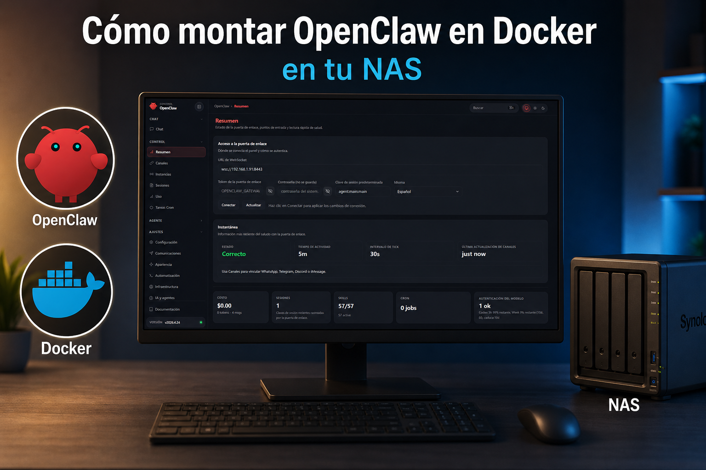

# OpenClaw on NAS

**English** | [Español](README.es.md)

<p align="center">
  
  
  
  
  
  
</p>

<p align="center">
  
</p>

Run [OpenClaw](https://openclaw.ai) on a NAS with Docker, local HTTPS and
**LAN-only** access. Do not port-forward OpenClaw from your router.

```text
LAN browser -> https://<nas-ip>:8443 -> Nginx TLS proxy -> OpenClaw gateway (127.0.0.1:18789)
```

The NAS runs a pre-built image published by this repository. It never builds
the image locally:

| Registry | Image |
| -------- | ----- |
| GitHub Container Registry (default) | `ghcr.io/luprintech/openclaw-nas-docker` |
| Docker Hub (mirror) | `luprintechdev/openclaw-nas-docker` |

GitHub Actions builds the image from `Dockerfile`, tests it and publishes it;
`docker-compose.yml` only pulls and runs it.

## Contents

- [Requirements](#requirements)
- [Video tutorial](#video-tutorial)
- [First install, step by step](#first-install-step-by-step)
- [Everyday commands](#everyday-commands)
- [Updating OpenClaw](#updating-openclaw)
- [Release channels](#release-channels)
- [Backups and restoring](#backups-and-restoring)
- [Re-running the installer](#re-running-the-installer)
- [Installing rootCA on client devices](#installing-rootca-on-client-devices)
- [Claude Code CLI](#claude-code-cli)
- [Installing Python skills](#installing-python-skills)
- [Troubleshooting](#troubleshooting)
- [Security rules](#security-rules)
- [Project documents](#project-documents)

---

## Requirements

- A NAS with an **x86-64 (amd64) CPU**. Images are published for `linux/amd64`
  only, so ARM-based models cannot run them.
- Docker with **Docker Compose v2** (`docker compose version` must work). On
  Synology, install **Container Manager** from the Package Center.
- SSH access to the NAS with a user that can run `docker`.
- `curl` on the NAS to download the installer and later updates.
- A stable LAN IP for the NAS (see step 0).

Tested on Synology DSM, including models with the Linux 4.4 kernel such as the
DS220+. It should work on other x86-64 NAS systems that run Docker (QNAP,
Ugreen, TerraMaster, Asustor, etc.).

---

## Video tutorial

[](https://youtu.be/lEqvOU_WuP0?si=V4EjXpC46ehEahsi)

---

## First install, step by step

The examples use `192.168.1.50` as the NAS IP and `/volume1/docker/openclaw` as
the install folder. Replace both with your own values.

> **Security rule:** keep OpenClaw LAN-only. Do **not** port-forward `8443` or
> `18789` from your router.

### 0. Give your NAS a stable LAN IP

The installer stores the NAS IP in `.env` and uses it for the dashboard URL, the
allowed browser origins and the HTTPS certificate. If the IP changes later,
those stop matching and you must re-run the installer with the new IP.

| Option | Recommended? | Tradeoff |
| ------ | ------------ | -------- |
| DHCP reservation in your router | **Best option** | The router always gives the NAS the same IP. Low risk, easy to undo. |
| Static IP in the NAS control panel | Good option | No router changes, but a wrong gateway, DNS or subnet can disconnect the NAS. |
| Static IP over SSH | Not recommended on Synology | DSM manages networking and can overwrite low-level changes. Easy to lock yourself out. |

**Recommended: reserve the IP in your router**

1. Open your router admin page and find the NAS in the DHCP / LAN clients list.
2. Copy its MAC address.
3. Create a DHCP reservation (also called static lease or address reservation)
   for that MAC, for example `192.168.1.50`.
4. Reboot the NAS or renew its network lease.
5. Confirm the NAS answers on that IP.

**Synology DSM: set a manual IP from the UI**

1. In DSM, open **Control Panel → Network → Network Interface**.
2. Select your active interface (usually **LAN 1**) and click **Edit**.
3. In IPv4, choose manual configuration and set the IP (for example
   `192.168.1.50`), subnet mask (usually `255.255.255.0`), gateway (your router,
   for example `192.168.1.1`) and DNS server.
4. Apply and reconnect to DSM using the new IP.

A wrong gateway, subnet or IP range can cut your access to DSM until you fix it
locally, so double-check the values. Use SSH only to check the current address
(`ip addr`), not to set a permanent one.

### 1. Connect to the NAS and create the install folder

| NAS | Suggested path |
| --- | -------------- |
| Synology | `/volume1/docker/openclaw` |
| QNAP | `/share/Container/openclaw` |
| Others | `/opt/openclaw` or any writable folder |

```bash
ssh your-user@192.168.1.50
mkdir -p /volume1/docker/openclaw
cd /volume1/docker/openclaw
```

On Synology, enable SSH first in **Control Panel → Terminal & SNMP**.

### 2. Download and run the installer

```bash
curl -fsSL https://raw.githubusercontent.com/luprintech/openclaw-nas-docker/main/install.sh -o install.sh
chmod +x install.sh
./install.sh 192.168.1.50
```

Run it from the install folder and keep `install.sh` there: you will use it
again if the IP or port changes. Do not run it as `bash <(curl ...)`, because
that form cannot find the install folder.

The installer:

1. Checks that Docker and Docker Compose v2 are available.
2. Creates `.env` with a random `OPENCLAW_GATEWAY_TOKEN`, your time zone and
   the NAS IP.
3. Generates a local certificate authority and an HTTPS certificate for the NAS
   IP under `certs/`.
4. Writes `docker-compose.yml`, `nginx/nginx.conf` and the `./openclaw` command
   wrapper.
5. Creates `config/` and `workspace/` and gives them to UID/GID 1000, the user
   that runs OpenClaw inside the container.
6. Downloads the image if it is not on the NAS yet and starts the stack.
7. Applies the allowed Control UI origins and the reverse-proxy settings.

When it finishes it prints the dashboard URL and the path of the root
certificate.

### 3. Trust the local root certificate on each device

The installer created a private certificate authority for your LAN. Copy its
root certificate from the NAS to every computer or phone that will open
OpenClaw:

- `certs/rootCA.cer` for Windows
- `certs/rootCA.pem` for macOS, iPhone/iPad, Android and Linux

You can copy it with File Station (Synology) or `scp`. Then install it as a
trusted root authority: see
[Installing rootCA on client devices](#installing-rootca-on-client-devices).

If you skip this step the browser warns that the connection is not private.
That is expected for a private LAN certificate.

### 4. Open the dashboard

Open the HTTPS URL in your browser:

```text
https://192.168.1.50:8443
```

There is no plain-HTTP address. Port `18789` only listens on the NAS itself
(`127.0.0.1`), so `http://192.168.1.50:18789` will not work from your computer.

If the dashboard asks for the gateway token, show it on the NAS and paste only
the value after `=`:

```bash
grep OPENCLAW_GATEWAY_TOKEN .env
```

### 5. Run onboarding and configure your AI provider

```bash
./openclaw onboard
```

Onboarding runs inside the container. Follow the prompts to choose your AI
provider and enter its API key or sign in. **This is where providers are
configured.**

The `.env` file contains empty entries such as `ANTHROPIC_API_KEY` or
`OPENAI_API_KEY`, but the containers do not read them. Filling them in has no
effect; use onboarding instead.

### 6. Pair your browser

Pairing authorizes your browser as a known device.

1. Print the dashboard and pairing information:

   ```bash
   ./openclaw dashboard
   ```

2. Open the printed URL in your browser, enter the gateway token if asked and
   start the pairing flow.
3. Back in SSH, list pending devices:

   ```bash
   ./openclaw devices
   ```

4. Copy the `request_id` of your browser and approve it:

   ```bash
   ./openclaw approve <request_id>
   ```

5. Refresh the browser. It is now paired.

### 7. Check that everything works

```bash
./openclaw status
./openclaw doctor
```

`status` should show both containers as `Up` and the gateway as `healthy`. If
something fails, look at the logs:

```bash
./openclaw logs openclaw-gateway
./openclaw logs nginx
```

Press `Ctrl+C` to stop following the logs.

---

## Everyday commands

Run them from the install folder.

**OpenClaw** (the stack must be running):

| Command | What it does |
| ------- | ------------ |
| `./openclaw onboard` | Runs OpenClaw onboarding |
| `./openclaw dashboard` | Prints the dashboard and pairing URL |
| `./openclaw devices` | Lists known and pending devices |
| `./openclaw approve <request_id>` | Approves a device pairing request |
| `./openclaw doctor` | Runs OpenClaw diagnostics |
| `./openclaw agent --message "hi"` | Talks to the assistant |
| `./openclaw message send --target <target> --message "hi"` | Sends a message through a channel |
| `./openclaw pip install <package>` | Installs a Python package for skills |
| `./openclaw claude` | Opens the Claude Code CLI |
| `./openclaw <anything else>` | Passes the command to the OpenClaw CLI, e.g. `./openclaw config get gateway.bind` |

**Stack:**

| Command | What it does |
| ------- | ------------ |
| `./openclaw start` | Creates and starts the containers (`docker compose up -d`). Applies changes to `.env` |
| `./openclaw stop` | Stops **and removes** the containers (`docker compose down`). Your data in `config/` and `workspace/` is kept |
| `./openclaw restart` | Restarts the existing containers. Does **not** apply `.env` changes: use `stop` + `start` for that |
| `./openclaw status` | Shows container status |
| `./openclaw logs [service]` | Follows the logs of all services or one (`openclaw-gateway`, `nginx`) |
| `./openclaw shell` | Opens a shell in a temporary CLI container |
| `./openclaw update` | Updates the stack files and the image, then migrates your data (see below) |
| `./openclaw help` | Shows the command list |

---

## Updating OpenClaw

Always update with:

```bash
cd /volume1/docker/openclaw
./openclaw update
```

The stack must be running. If you stopped it, run `./openclaw start` first.

What `./openclaw update` does, in order:

1. Shows the updater banner and downloads the latest `install.sh`,
   `docker-compose.yml`, `openclaw` and `scripts/migrate-openclaw.sh` from this
   repository (or runs `git pull` if the folder is a Git clone).
2. Pulls the configured image (`:latest` by default).
3. Backs up your OpenClaw data, `.env`, `docker-compose.yml` and `nginx/` into
   a new `openclaw-backup-<date>-<time>` folder (see
   [Backups and restoring](#backups-and-restoring)).
4. Stops the gateway, repairs file ownership, and runs the data migrations
   required by the new OpenClaw version.
5. Starts the gateway, waits until it is healthy (up to 2 minutes) and restarts
   Nginx.

When it finishes, check the result:

```bash
./openclaw status
```

> **Do not update with `docker compose pull` and `up -d` alone.** That skips
> the data migration: recent OpenClaw versions then start with a degraded agent
> database, Docker still reports the gateway as healthy and the Control UI does
> not load. If that already happened, run
> `bash scripts/migrate-openclaw.sh upgrade`.

If an update fails, do not restart the gateway again and again. Keep the backup
folder it printed and look at the logs:

```bash
docker compose ps
docker compose logs --since 5m --tail=120 openclaw-gateway
```

The updater never deletes backups and never restores data on its own, so you
keep the evidence and decide what to do.

On Synology, `openclaw doctor --fix` can print
`EPERM: operation not permitted, fchmod`. It is harmless only if the update
finishes, the gateway log shows `gateway ready` and `./openclaw status` shows the
gateway as `healthy`.

> [!IMPORTANT]
> **Installed before the Synology 2026.9.9 compatibility update?** Refresh the
> `./openclaw` wrapper once before your first update. It does not touch your
> configuration, workspace or sessions:
>
> ```bash
> curl -fsSL https://raw.githubusercontent.com/luprintech/openclaw-nas-docker/main/install.sh -o install.sh
> bash install.sh --wrapper-only
> ./openclaw update
> ```

---

## Release channels

Every image is published under several tags:

| Tag | When it changes | Use it if |
| --- | --------------- | --------- |
| `latest` (default) | Only after the version has been tested on a real Synology NAS | You want a stable NAS. `install.sh` and `docker-compose.yml` use it |
| `edge` | As soon as a new OpenClaw version passes the automated tests | You want new versions early and can recover from a broken update |
| `<version>` (e.g. `2026.11.6`) | Never; it always points to the same image | You want to refer to an exact build |

How a new OpenClaw version reaches `latest`:

1. Every six hours a workflow checks for a new **stable** OpenClaw release
   (prereleases are ignored).
2. CI builds the image and runs `scripts/smoke-test.sh`: clean start, upgrade
   from the current `latest` on the same data, healthy gateway, no degraded
   agent database and a working `claude` CLI. If anything fails, nothing is
   published and an issue labelled `openclaw-update-failed` is opened.
3. If the tests pass, a pull request pins the version on `main` and is merged
   automatically. The image is published as `:<version>` and `:edge` on GHCR
   and Docker Hub, with a GitHub prerelease and an issue labelled
   `release-candidate` that contains the NAS checklist.
4. The maintainer tests that image on a Synology NAS. CI runners use a modern
   kernel and cannot reproduce problems specific to the Linux 4.4 kernel of
   some Synology models (for example the missing `openat2` call).
5. The maintainer runs the **Promote to stable** workflow. It copies that exact
   image to `:latest` on both registries without rebuilding it, marks the
   GitHub release as latest and closes the checklist issue. Running it with an
   older version rolls `latest` back.

After a promotion or a rollback, run `./openclaw update` on your NAS to get it.

### Following `edge`

1. Edit `.env` and set:

   ```env
   OPENCLAW_IMAGE=ghcr.io/luprintech/openclaw-nas-docker:edge
   ```

2. Run `./openclaw update`.

To go back to `latest`, leave the value empty (`OPENCLAW_IMAGE=`) and run
`./openclaw update`. If `edge` was newer than `latest`, this is a downgrade:
data migrations are not reversible, so restore the backup made before you
switched (see [Backups and restoring](#backups-and-restoring)).

> **Version pins:** `./openclaw update` resets an
> `OPENCLAW_IMAGE=ghcr.io/luprintech/openclaw-nas-docker:<version>` value to
> empty, so a GHCR version pin does not survive an update. Use `latest` or
> `edge`.

---

## Backups and restoring

Every `./openclaw update` creates a folder next to your installation:

```text
openclaw-backup-YYYYMMDD-HHMMSS/
├── openclaw-home/       # OpenClaw data: config, sessions, agents, workspace, Claude login
├── .env
├── docker-compose.yml
└── nginx/
```

Set `OPENCLAW_BACKUP_ROOT` before running the update to store them somewhere
else. Backups contain your gateway token, provider keys and Claude login in
plain text: keep them private and delete old ones you no longer need.

To restore a backup (for example after a failed update):

1. Stop the stack:

   ```bash
   cd /volume1/docker/openclaw
   ./openclaw stop
   ```

2. Move the current data aside instead of deleting it:

   ```bash
   mv config config.before-restore
   mv workspace workspace.before-restore
   ```

3. Copy the backup back with the right owner. A temporary container does the
   copy, because the SSH user may not be allowed to read files owned by UID
   1000:

   ```bash
   B=openclaw-backup-YYYYMMDD-HHMMSS
   docker run --rm -v "$PWD:/w" alpine sh -c \
     "cp -a /w/$B/openclaw-home /w/config \
      && if [ -d /w/config/workspace ]; then mv /w/config/workspace /w/workspace; else mkdir /w/workspace; fi \
      && chown -R 1000:1000 /w/config /w/workspace"
   ```

4. Pin the version you were running before the update (see the
   [releases](https://github.com/Luprintech/openclaw-nas-docker/releases) if
   you are not sure) in `.env`, for example:

   ```env
   OPENCLAW_IMAGE=ghcr.io/luprintech/openclaw-nas-docker:2026.11.5
   ```

5. Start the stack with `./openclaw start` (not `update`, which would clear the
   pin and migrate again) and check `./openclaw status`.

When everything works, you can delete `config.before-restore` and
`workspace.before-restore`. Remove the pin and run `./openclaw update` again
once a fixed version is on `latest`.

---

## Re-running the installer

Re-run the installer only to change the NAS IP or HTTPS port, or to repair the
installation:

```bash
./install.sh 192.168.1.60   # new IP
./install.sh                # same IP, read from .env
```

It keeps your token, data and certificate authority. It rewrites
`docker-compose.yml`, issues a new HTTPS certificate, repairs file ownership and
re-applies the allowed origins and proxy settings. Existing `nginx/nginx.conf`
and `./openclaw` files are left as they are.

The installer does **not** update OpenClaw: it does not pull a newer image or
migrate data. Use `./openclaw update` for that.

To change the HTTPS port, edit `OPENCLAW_HTTPS_PORT` in `.env` and re-run
`./install.sh`, so the allowed origins match the new port.

---

## Installing rootCA on client devices

### Windows

1. Copy `certs/rootCA.cer` to the PC.
2. Double-click it and choose **Install Certificate**.
3. Choose **Local Machine**.
4. Place it in **Trusted Root Certification Authorities**.

### macOS

1. Open `rootCA.pem`: Keychain Access adds it to the System keychain.
2. Open the certificate and set **When using this certificate** to
   **Always Trust**.

### iPhone / iPad

1. Open `rootCA.pem` on the device and install the profile.
2. Go to **Settings → General → About → Certificate Trust Settings**.
3. Enable full trust for the certificate.

### Android

```text
Settings → Security → Encryption & credentials → Install a certificate → CA certificate
```

Menu names vary by manufacturer.

The certificate authority is created once and reused. Re-running the installer
issues a new server certificate signed by the same authority, so devices that
already trust it do not need to install it again.

---

## Claude Code CLI

The image includes Claude Code. `./openclaw claude` opens it in a temporary
container, and the OpenClaw gateway can use the same CLI as its `claude-cli`
model backend (see the
[OpenClaw CLI backends documentation](https://docs.openclaw.ai/gateway/cli-backends)).

Both containers set `CLAUDE_CONFIG_DIR=/home/node/.openclaw/claude`, which is
`config/claude` on the NAS. Your Claude login, settings, memory and history
live there, so they survive closing the CLI, restarting the stack and updating
the image. Installations that update from an older release need to sign in
once more.

Sign in once, then check the status:

```bash
./openclaw claude                # then run /login and follow the prompts
docker compose exec openclaw-gateway claude auth status --text
```

Claude Code accepts an Anthropic account login or an API key. For shared or
continuous automation through the gateway, OpenClaw's documentation recommends
an API key for predictable billing
([Docker storage](https://docs.openclaw.ai/install/docker/networking-and-storage)).
If you sign in with an account, check Anthropic's current terms and usage
limits for third-party tools.

`config/claude` stores your Claude login token in plain text, like the gateway
token in `.env`. Do not share or commit it.

---

## Installing Python skills

The container includes Python 3 and pip. Packages go into a virtual environment
at `/home/node/.openclaw/python-venv`, inside `config/`, so they survive
restarts and image updates.

```bash
./openclaw pip install <package>
```

If you get `Unknown command: openclaw pip`, your wrapper is outdated. Refresh it
once:

```bash
curl -fsSL https://raw.githubusercontent.com/luprintech/openclaw-nas-docker/main/install.sh -o install.sh
bash install.sh --wrapper-only
```

From then on, `./openclaw update` keeps the wrapper up to date.

---

## Troubleshooting

### `OpenClaw gateway container is not running; start the stack before updating`

`./openclaw update` needs the gateway container to exist, because it backs up
your data from it. This happens after `./openclaw stop` or if the container
was deleted in Container Manager. Your data in `config/` and `workspace/` is
safe. Start the stack and update again:

```bash
./openclaw start
./openclaw update
```

### The Control UI does not load after an update

You probably updated with `docker compose pull` / `up -d` instead of
`./openclaw update`, so the data migration did not run:

```bash
bash scripts/migrate-openclaw.sh upgrade
```

### Plugin requires a newer plugin API than this OpenClaw runtime

```text
Plugin "@openclaw/whatsapp" requires plugin API >=2026.10.1, but this OpenClaw
runtime exposes 2026.9.9.
```

The plugin was published for a newer OpenClaw version than the one you run.
Update, check your version and retry:

```bash
./openclaw update
docker compose exec openclaw-gateway node dist/index.js --version
```

If the plugin still needs a newer version, that OpenClaw release has not reached
`latest` yet (see [Release channels](#release-channels)). Wait for the next
promotion or switch to `edge` if you accept the risk.

### EACCES: permission denied

OpenClaw runs as UID/GID `1000` inside the container. If the data folders
belong to another user you see errors like:

```text
EACCES: permission denied, open '/home/node/.openclaw/openclaw.json...tmp'
```

Fix the owner with a temporary container (works without `sudo`):

```bash
docker run --rm -v "$PWD:/w" alpine chown -R 1000:1000 /w/config /w/workspace
./openclaw restart
```

If certificate generation fails with permission denied under `certs/`:

```bash
sudo chown -R "$(id -u):$(id -g)" certs
chmod -R u+rwX certs
```

### Container name conflicts

```text
Conflict. The container name "/openclaw-gateway" is already in use
```

These are leftovers from an older install that used fixed container names:

```bash
docker ps -a --filter name=openclaw
docker stop openclaw-gateway openclaw-cli openclaw-nginx 2>/dev/null || true
docker rm   openclaw-gateway openclaw-cli openclaw-nginx 2>/dev/null || true
./install.sh
```

### The NAS IP changed

The dashboard URL, the certificate and the allowed origins still point to the
old IP. Re-run the installer with the new one:

```bash
./install.sh <new-nas-ip>
```

---

## Security rules

- Do not port-forward `8443` or `18789` from the router.
- Keep `certs/` private, especially the certificate authority key.
- Never share or commit `.env`, `config/` or `openclaw-backup-*` folders: they
  contain your gateway token and logins.
- Install only OpenClaw skills and plugins you trust.

The installer binds the gateway to `127.0.0.1` and Nginx to the NAS LAN IP, and
configures Nginx to overwrite `X-Forwarded-For` with the real client address.
It adds only the current Nginx container IP to `gateway.trustedProxies`, and
`./openclaw update` refreshes it. Do not replace it with a broad Docker subnet.

---

## Project documents

- [Contributing](CONTRIBUTING.md)
- [Code of conduct](CODE_OF_CONDUCT.md)
- [Security policy](SECURITY.md)
- [MIT license](LICENSE)
